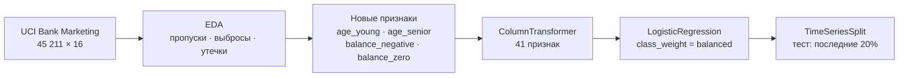

<div align="center">

# Прогноз отклика клиентов банка на срочный вклад

**EDA · sklearn-пайплайн · своя линейная регрессия на NumPy · честная временная валидация**

[](https://www.python.org/)
[](https://numpy.org/)
[](https://pandas.pydata.org/)
[](https://scikit-learn.org/)
[](https://jupyter.org/)
[](https://archive.ics.uci.edu/dataset/222/bank+marketing)

</div>

Банк обзванивает клиентов с предложением открыть срочный вклад. Модель оценивает вероятность согласия **до звонка**, чтобы колл-центр звонил в первую очередь самым перспективным клиентам.

Данные — [UCI Bank Marketing](https://archive.ics.uci.edu/dataset/222/bank+marketing): 45 211 записей, 16 признаков, май 2008 — ноябрь 2010. Положительный класс — **11.7%**.

## Ключевые результаты

| Показатель | Значение |
|---|---|
| ROC-AUC на будущем периоде (временная схема) | **0.668** |
| Lift в топ-20% клиентов по скору | **1.84×**: 58% согласий против 32% |
| Завышение оценки при случайном разбиении | **+0.094** ROC-AUC (0.762 против 0.668) |
| Утечка в `duration` | ROC-AUC 0.762 → 0.895, признак исключён |
| `MyLinearRegression` против `sklearn` | max \|Δw\| = **2.9·10⁻¹⁵** |

## Ноутбуки

| Ноутбук | Что внутри | Colab |
|---|---|:-:|
| [`hw_1.ipynb`](hw_1.ipynb) | EDA, пропуски и выбросы, feature engineering, `Pipeline` + `ColumnTransformer`, анализ утечек, дисбаланс классов | [](https://colab.research.google.com/github/Meytardzhevtd/ml-course/blob/main/hw_1.ipynb) |
| [`hw_2.ipynb`](hw_2.ipynb) | Своя линейная регрессия (MSE / Huber / MAE), сверка со `sklearn`, временная валидация, подбор порога | [](https://colab.research.google.com/github/Meytardzhevtd/ml-course/blob/main/hw_2.ipynb) |

## Пайплайн



| Признаки | Обработка | Обоснование |
|---|---|---|
| `balance` | sign(x)·ln(1 + \|x\|), стандартизация | skew = 8.36, 8.3% отрицательных значений |
| `campaign`, `previous` | ln(1 + x), стандартизация | длинный хвост, аномальное значение `previous = 275` |
| `pdays` | −1 → 999, стандартизация | −1 означает «раньше не звонили», а не число дней |
| `day`, `month` | sin / cos | циклические: 31-е и 1-е число — соседние дни |
| `education`, `contact` | пропуск → `unknown`, one-hot | пропуск в `contact` связан с целью: 4.1% согласий против 13–15% |
| `poutcome` | пропуск → `nonexistent`, one-hot | 81.7% структурных пропусков: прошлой кампании не было |
| `duration` | **исключён** | известен только после звонка — утечка целевой переменной |

Вся предобработка выполняется внутри `Pipeline`: параметры считаются только на обучающих данных, отдельно в каждом блоке кросс-валидации. Тестовая выборка используется один раз, `random_state = 42`.

## 1. Анализ данных и базовая модель · `hw_1`

- Столбец `day_of_week` в Python-версии датасета на самом деле содержит день месяца (значения 1–31). Признак переименован в `day`.
- `pdays = −1`, `previous = 0` и пустой `poutcome` совпадают у одних и тех же 36 954 клиентов (81.7%). Это одно событие «прошлой кампании не было», а не три независимых пропуска.
- Связь возраста с откликом U-образная: 24% согласий в 18–25 лет, 40–45% после 60. Корреляция Спирмена при этом ≈ −0.01, и отбор признаков по корреляции потерял бы сильный сигнал.
- Сильнейший легальный признак — успех в прошлой кампании: 64.7% согласий против 11.7% в среднем.
- Доля согласий растёт во времени с 3.0% до 47.1%. Это мотивирует временную валидацию в разделе 3.

**Результаты на стратифицированном тесте (20%)**

| Модель | ROC-AUC | F1 | Precision | Recall |
|---|:-:|:-:|:-:|:-:|
| Dummy (`most_frequent`) | 0.500 | 0.000 | 0.000 | 0.000 |
| Dummy (`stratified`) | 0.497 | 0.109 | 0.112 | 0.107 |
| LogisticRegression | 0.762 | 0.260 | 0.668 | 0.162 |
| LogisticRegression + `class_weight` | **0.762** | **0.358** | 0.246 | 0.654 |
| *с `duration` — утечка, не используется* | *0.895* | *0.438* | *0.638* | *0.334* |

- Веса классов, undersampling и oversampling дают одинаковый ROC-AUC (0.754 на CV) и поднимают F1 с 0.263 до 0.355. Выбраны веса классов: они не отбрасывают и не дублируют данные.
- Заполнение пропусков модой снижает ROC-AUC с 0.7542 до 0.7365. Пропуск как отдельная категория или флаг пропуска сохраняют качество.

## 2. Собственная линейная регрессия · `hw_2`

`MyLinearRegression` — векторизованная реализация на NumPy с API `sklearn` (`BaseEstimator`, `RegressorMixin`). Класс работает в `Pipeline`, `cross_val_score`, `GridSearchCV` и `RandomizedSearchCV` без обёрток. Полигон — логарифм баланса по анкетным данным: цель раздела — корректность реализации, а не качество (R² ≈ 0.08).

| Возможность | Реализация |
|---|---|
| Функции потерь | MSE, Huber, MAE (субградиент) |
| Обучение | полный, мини-пакетный и стохастический градиентный спуск; нормальное уравнение |
| Регуляризация | L2, свободный член не штрафуется |
| Веса объектов | `fit(X, y, sample_weight=...)` |
| Шаг обучения | 1/λ_max по кривизне функции потерь; стандартизация снизила число обусловленности с 417 до 25 |

| Сверка со `sklearn` | Расхождение |
|---|---|
| MSE против `LinearRegression` | 2.9·10⁻¹⁵ |
| MSE + L2 против `Ridge` (α_R = n·α) | 2.3·10⁻¹⁴ |
| `sample_weight` против `LinearRegression` | 1.8·10⁻¹⁵ |
| Huber против `HuberRegressor` (δ = ε·σ) | 7.4·10⁻⁵ |
| MAE против `QuantileRegressor` (q = 0.5) | 2.2·10⁻⁷, отн. разница функции потерь |

**Устойчивость к выбросам:** 2.5% целевых значений в обучающей выборке умножены на 10.

| Функция потерь | Сдвиг весов, max | Сдвиг прогноза на тесте |
|---|:-:|:-:|
| MSE | 0.2646 | 1.215 |
| Huber | 0.0075 | 0.055 |
| MAE | 0.0087 | 0.041 |

Huber и MAE ограничивают вклад объекта в градиент, поэтому выбросы почти не сдвигают модель. Для MSE тот же эффект даёт ручное занижение весов: правило \|y\| > 12 нашло 895 из 904 выбросов без ложных срабатываний.

При равном бюджете в 60 обучений `RandomizedSearchCV` проверил 12 значений `lr` против 3 у `GridSearchCV` и нашёл лучшую конфигурацию (R² 0.0898 против 0.0890).

## 3. Честная валидация · `hw_2`

Записи упорядочены по времени, и доля согласий сильно дрейфует: 6.7% в первых 80% записей и 31.6% в последних 20%. Случайное разбиение смешивает периоды и показывает модели «будущее». Поэтому тест — последние 20% записей, кросс-валидация — `TimeSeriesSplit` на 5 блоков.

| Схема разбиения | ROC-AUC, CV | ROC-AUC, тест |
|---|:-:|:-:|
| Случайная, стратифицированная | 0.670 ± 0.014 | 0.762 |
| Временная | 0.550 ± 0.062 | **0.668** |

- **Метрики выбраны по цене ошибок.** Пропустить согласного клиента дороже, чем сделать лишний звонок, поэтому порог подбирается по F2. Модели сравниваются по ROC-AUC: он не зависит от доли положительного класса, которая меняется от 4% до 32%.
- **Регуляризация почти не влияет:** ROC-AUC 0.542–0.552 при α от 10⁻³ до 10³. Качество ограничено дрейфом между периодами, а не переобучением.
- **Порог по F2 равен 0.185** и соответствует обзвону почти всех клиентов (98.9%). Ценность модели — в ранжировании: при ограниченной мощности колл-центра звонки по топ-20% списка в 1.84 раза результативнее случайных.

## Ограничения и следующие шаги

- Главный предел качества — дрейф во времени. В данных нет года и макроэкономических признаков, поэтому рост вероятнее от признаков периода и регулярного переобучения, чем от усложнения модели.
- Градиентный бустинг — следующий кандидат, но только с временной схемой. У 13.8% тестовых объектов профиль клиента совпадает с объектами из train, и модели, способные запоминать объекты, получат завышенную оценку при случайном разбиении.
- Рабочую точку лучше задавать долей обзваниваемых клиентов, а не порогом вероятности.

## Запуск

Быстрее всего — кнопкой **Open in Colab** в таблице выше. Локально:

```bash
git clone https://github.com/Meytardzhevtd/ml-course.git && cd ml-course
python -m venv .venv && source .venv/bin/activate
pip install numpy pandas scipy matplotlib seaborn "scikit-learn>=1.2" imbalanced-learn ucimlrepo jupyterlab
jupyter lab
```

Датасет скачивается при первом запуске через `ucimlrepo`, нужен доступ в интернет.

## Источник данных

Moro S., Cortez P., Rita P. *A data-driven approach to predict the success of bank telemarketing.* Decision Support Systems, 62, 22–31, 2014. Лицензия данных — [CC BY 4.0](https://creativecommons.org/licenses/by/4.0/).
